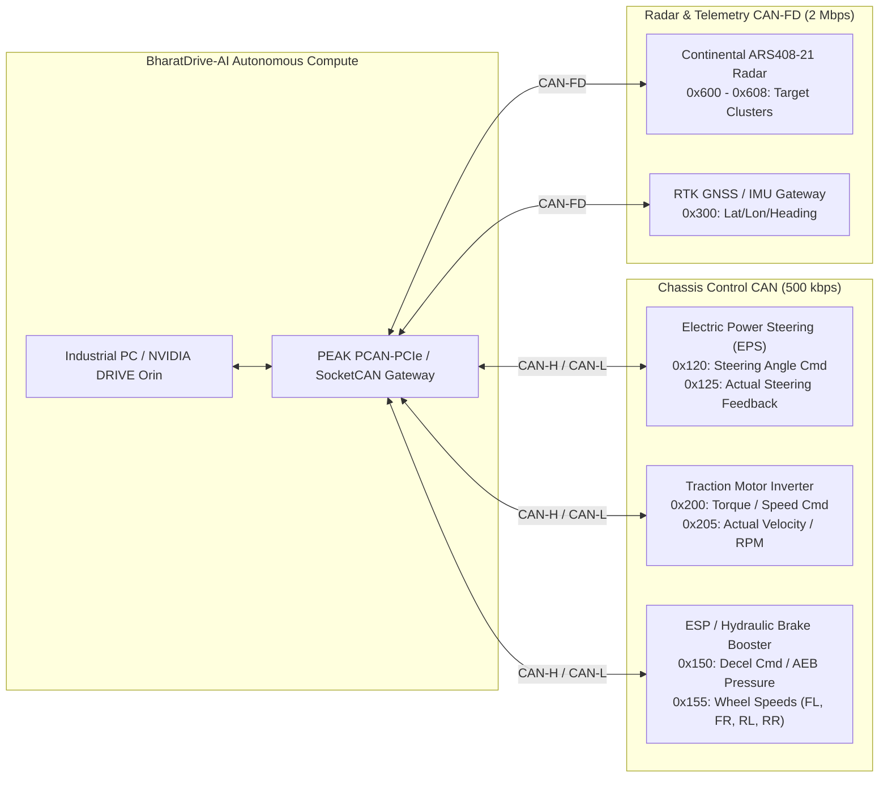
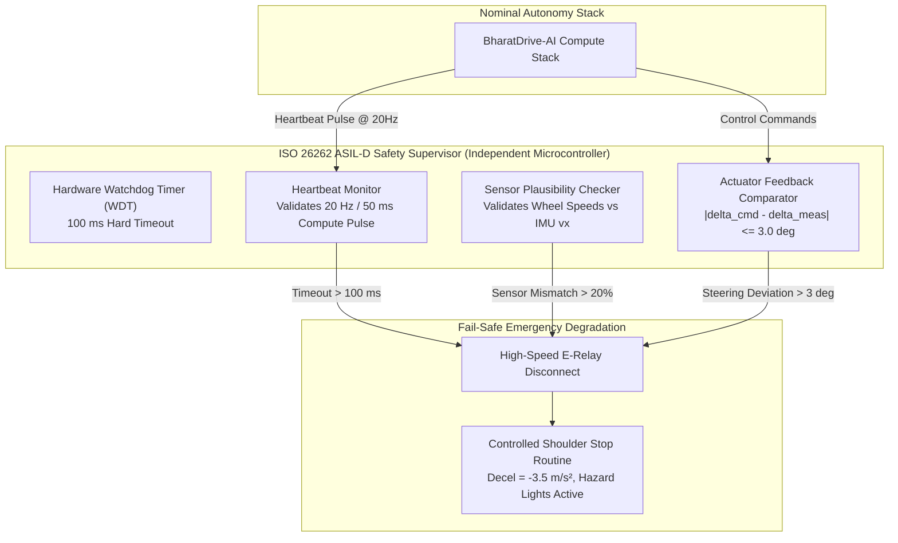

# BharatDrive-AI: In-Vehicle Hardware Deployment & Real-Time Integration Guide

This guide specifies the hardware specifications, operating system setup, CAN-bus integration, containerization, and **ISO 26262 ASIL-D** functional safety watchdogs required to transition **BharatDrive-AI** from closed-loop co-simulation to an in-vehicle automotive testbed (e.g., Tata Nexon EV / Mahindra XUV400).

---

## 1. Hardware Architecture & Tiering Options

BharatDrive-AI supports three deployment hardware tiers depending on development and validation requirements:

```text
┌────────────────────────────────────────────────────────────────────────────────────────────────────┐
│ BHARATDRIVE-AI HARDWARE DEPLOYMENT TIERS                                                           │
├───────────────┬───────────────────────────────┬──────────────────────────────┬─────────────────────┤
│ Component     │ Tier 1: Embedded Automotive   │ Tier 2: Real-Time HIL Target │ Tier 3: Dev Testbed │
│               │ (Production Target)           │ (dSPACE Hardware-in-the-Loop)│ (In-Vehicle IPC)    │
├───────────────┼───────────────────────────────┼──────────────────────────────┼─────────────────────┤
│ Compute SoC / │ NVIDIA DRIVE AGX Orin         │ dSPACE MicroAutoBox III      │ Neousys Nuvo-9166GC │
│ CPU Platform  │ (12-core ARM Cortex-A78AE)    │ (Quad-Core ARM Cortex-A53    │ (Intel Core i9-13900TE│
│               │ 275 TOPS INT8 / 64GB LPDDR5   │ + Xilinx UltraScale+ FPGA)   │ + NVIDIA RTX 4090)  │
├───────────────┼───────────────────────────────┼──────────────────────────────┼─────────────────────┤
│ Real-Time OS  │ DRIVE OS 6.0 Linux            │ dSPACE Real-Time Kernel      │ Ubuntu 22.04 LTS    │
│               │ (QNX Safety OS Optional)      │ (TargetLink Generated)       │ RT-PREEMPT v6.1     │
├───────────────┼───────────────────────────────┼──────────────────────────────┼─────────────────────┤
│ Perception    │ TensorRT Engine (YOLO INT8)   │ Bypass (Simulated Virtual    │ TensorRT / PyTorch  │
│ Execution     │ Deep Learning Accelerator     │ Sensor Ingestion)            │ CUDA 12.4 Engine    │
├───────────────┼───────────────────────────────┼──────────────────────────────┼─────────────────────┤
│ Motion Control│ Dual lockstep ARM cores       │ FPGA Fast Control Loop       │ CPU Core Affinity   │
│ Loop Rate     │ 50 Hz deterministic           │ 100 Hz deterministic         │ 50 Hz deterministic │
├───────────────┼───────────────────────────────┼──────────────────────────────┼─────────────────────┤
│ Power Draw    │ ~65W (Automotive 12V/24V)     │ ~40W (Vehicle Power Supply)  │ ~350W (DC-DC Invert)│
└───────────────┴───────────────────────────────┴──────────────────────────────┴─────────────────────┘
```

---

## 2. In-Vehicle CAN-Bus Network Topology & DBC Mapping

The ego vehicle communicates with BharatDrive-AI via dual isolated CAN networks:
1. **Chassis Control CAN (CAN 0 - 500 kbps High Speed)**: Connects to EPS (Electric Power Steering), Electronic Stability Program (ESP), and Traction Inverter.
2. **Sensor Radar / Telemetry CAN (CAN 1 - CAN-FD 2 Mbps)**: Continental ARS408 Radar feeds and high-speed diagnostic telemetry.



### DBC Message Definitions (Excerpts from `bharatdrive_chassis.dbc`)

```text
BO_ 288 BHARATDRIVE_STEER_CMD: 8 BHARATDRIVE_COMPUTE
 SG_ SteerAngleTarget_deg : 0|16@1- (0.1,0) [-35.0|35.0] "deg" EPS
 SG_ SteerRateLimit_deg_s : 16|8@1+ (1.0,0) [0|40] "deg/s" EPS
 SG_ SteerEnable_Bit      : 24|1@1+ (1.0,0) [0|1] "" EPS
 SG_ SteerRollingCounter  : 28|4@1+ (1.0,0) [0|15] "" EPS
 SG_ SteerChecksum        : 56|8@1+ (1.0,0) [0|255] "" EPS

BO_ 336 BHARATDRIVE_BRAKE_CMD: 8 BHARATDRIVE_COMPUTE
 SG_ DecelTarget_mps2     : 0|12@1+ (0.01,0) [0.0|7.0] "m/s^2" ESP
 SG_ AEB_ActiveFlag       : 12|1@1+ (1.0,0) [0|1] "" ESP
 SG_ ServiceBrakeEnable   : 13|1@1+ (1.0,0) [0|1] "" ESP
 SG_ BrakePressure_bar    : 16|12@1+ (0.1,0) [0|150.0] "bar" ESP
 SG_ BrakeChecksum        : 56|8@1+ (1.0,0) [0|255] "" ESP
```

---

## 3. Real-Time OS & Middleware Configuration

### 3.1 Kernel Configuration (Ubuntu 22.04 LTS RT-PREEMPT)
Ensure the Linux real-time patch is active to guarantee deterministic latency under 150 microseconds:
```bash
# Verify RT-PREEMPT kernel
uname -v | grep PREEMPT_RT
# Output: #1 SMP PREEMPT_RT ...
```

### 3.2 Thread Priority & Core Affinity Setup
Allocate CPU cores strictly to prevent jitter:
- **Cores 0-3**: OS, ROS 2 background daemon, and network I/O.
- **Cores 4-7**: Real-Time Motion Control Loop (FIFO priority 98, core affinity bound).
- **Cores 8-11**: Frenet & Hybrid A* Motion Planning (FIFO priority 85).
- **GPU (CUDA / TensorRT)**: YOLO perception and point cloud clustering.

```bash
# Set Real-Time FIFO Priority for BharatDrive Control Daemon
sudo chrt -f 98 python python/scripts/run_vehicle_controller.py
```

### 3.3 SocketCAN Interface Initialization
```bash
# Bring up dual CAN-FD interfaces
sudo ip link set can0 up type can bitrate 500000 sample-point 0.8
sudo ip link set can1 up type can bitrate 500000 dbitrate 2000000 fd on
```

---

## 4. Containerization & Production Build (Docker)

A multi-stage Docker environment with NVIDIA Container Toolkit provides complete environment isolation and reproducible execution:

```dockerfile
# Production Dockerfile: BharatDrive-AI Autonomous Runtime
FROM nvidia/cuda:12.4.1-runtime-ubuntu22.04 AS base

ENV DEBIAN_FRONTEND=noninteractive
RUN apt-get update && apt-get install -y --no-install-recommends \
    python3-pip python3-dev libgl1-mesa-glx libglib2.0-0 can-utils \
    iproute2 net-tools build-essential && rm -rf /var/lib/apt/lists/*

WORKDIR /app
COPY requirements.txt .
RUN pip3 install --no-cache-dir -r requirements.txt

# Copy BharatDrive-AI Production Artifacts
COPY config/ ./config/
COPY python/ ./python/
COPY reports/figures/ ./reports/figures/
COPY dashboard/ ./dashboard/

# Compile Python C-Extensions & Verify Pytest Suite
RUN python3 -m pytest python/tests -q

EXPOSE 8085
CMD ["python3", "-m", "http.server", "8085", "--directory", "/app"]
```

Build and run:
```bash
# Build production image
docker build -t bharatdrive-ai:v2.5 .

# Launch with GPU acceleration and host CAN-bus pass-through
docker run -d --restart always \
  --net=host \
  --gpus all \
  --cap-add=SYS_NICE \
  --device=/dev/net/tun \
  --name bharatdrive_runtime \
  bharatdrive-ai:v2.5
```

---

## 5. ISO 26262 ASIL-D Functional Safety Architecture

Autonomous operations on public roads require strict adherence to automotive functional safety standards:



### Safety Principles:
1. **Hardware Heartbeat**: The main perception/planning compute must toggle a hardware GPIO pin at 20 Hz ($\pm 5\text{ ms}$). If no pulse is received within 100 ms, the independent safety microcontroller asserts emergency safe stop.
2. **Actuator Plausibility Gating**: Commanded steering angles $\delta_{\text{cmd}}$ that exceed maximum physical slew rates ($40^\circ/\text{s}$) or diverge from actual wheel feedback by $> 3.0^\circ$ for more than 150 ms immediately trigger open-circuit disconnect and manual driver override.
3. **Graceful Degraded Stopping**: In the event of a front camera/LiDAR occlusion (e.g., severe mud splash or camera disconnect), the vehicle executes a smooth pull-over to the unpaved shoulder at $a = -2.5\text{ m/s}^2$ rather than an abrupt mid-lane freeze.

---

## 6. Pre-Flight Vehicle Bringup Checklist

Prior to engaging autonomous mode on an in-vehicle test track:
1. **GNSS RTK Fix**: Confirm RTK carrier-phase lock (`Fix Type: 4, Horizontal Accur < 0.03 m`).
2. **LiDAR Point Cloud Sync**: Verify packet rate $\ge 19.8\text{ Hz}$ on `1000BASE-T1` interface.
3. **CAN Communication Plausibility**: Check that 0x120 (Steer Cmd) and 0x336 (Brake Cmd) counters increment monotonically without CRC errors.
4. **Emergency Stop Button (E-Stop)**: Verify physical latching E-stop mushroom switch in cabin cuts actuator relay power instantaneously.
5. **Driver Takeover Verification**: Confirm applying manual steering wheel torque $> 3.5\text{ Nm}$ or tapping the brake pedal disengages autonomous steering within $50\text{ ms}$.
