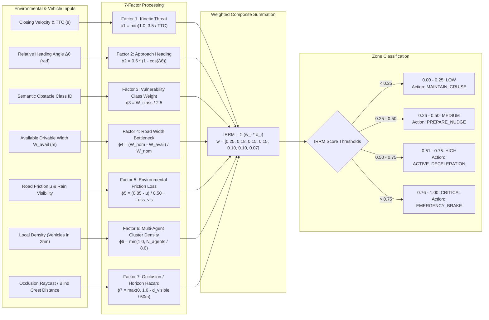
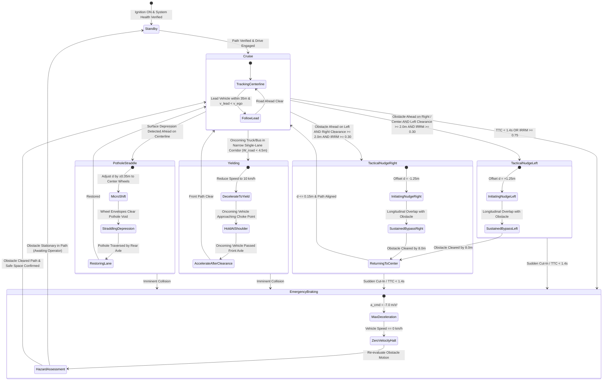

# BharatDrive-AI: Real-Time Execution Flowcharts & Algorithms

This document details the operational flowcharts, algorithmic sequences, and decision logic that govern **BharatDrive-AI** during real-time closed-loop autonomous driving.

---

## 1. Master Autonomous Control Loop Flowchart (20 Hz / 50 ms Cycle)

Every 50 ms, the system executes an end-to-end cycle from sensor ingestion to actuator PWM output:

```mermaid
flowchart TD
    Start([Timer Interrupt: 20 Hz / 50 ms Tick]) --> ReadSensors[Read Sensor Ingestion Buffers:<br/>Camera, LiDAR Point Cloud, Radar, RTK GNSS/IMU]
    
    ReadSensors --> SensorCheck{Sensors Healthy & Calibrated?}
    SensorCheck -- No --> SensorFault[Flag Sensor Degradation<br/>Switch to Safe Degraded Mode]
    SensorFault --> FailSafeStop[Execute Controlled Shoulder Stop]
    FailSafeStop --> EndCycle([End Cycle / Await Next Tick])

    SensorCheck -- Yes --> SyncFrames[Temporal & Spatial Synchronization<br/>Transform to ISO 8855 Ego Frame]
    
    SyncFrames --> Perception[Perception Pipeline:<br/>1. YOLOv8 Multi-Class Obstacle Detection<br/>2. 3D Pothole Ground Clustering<br/>3. Road Corridor Shoulder Extraction]
    
    Perception --> Tracker[Hungarian Association & EKF Fusion:<br/>Update Tracked Objects Registry]
    
    Tracker --> IRRM_Engine[7-Factor IRRM Risk Assessment Engine:<br/>Compute Spatio-Temporal Danger Field]
    
    IRRM_Engine --> EvalTTC[Compute Time-to-Collision TTC<br/>using Oriented Bounding Box SAT Intersections]
    
    EvalTTC --> CriticalityCheck{Risk Criticality Zone?}
    
    CriticalityCheck -- "CRITICAL (TTC < 1.4s)" --> AEB_Trigger[Trigger AEB Emergency Braking:<br/>Decel = -7.0 m/s², Hazard Lights Active]
    AEB_Trigger --> ControlOutput
    
    CriticalityCheck -- "SAFE / CAUTION / WARNING" --> StateflowLogic[Hierarchical Stateflow Decision Engine:<br/>Determine Operational Maneuver State]
    
    StateflowLogic --> ManeuverSelect{Selected Maneuver?}
    
    ManeuverSelect -- "Cruise / Lane Keep" --> PathPlan[Generate Baseline Corridor Path<br/>d_target = 0.0 m]
    ManeuverSelect -- "Tactical Nudge Left" --> PathPlanNudgeL[Generate Lateral Nudge Path<br/>d_target = +1.25 m]
    ManeuverSelect -- "Tactical Nudge Right" --> PathPlanNudgeR[Generate Lateral Nudge Path<br/>d_target = -1.25 m]
    ManeuverSelect -- "Yield / Gap Accept" --> PathPlanYield[Calculate Deceleration Envelope<br/>Target Speed = 10-15 km/h]
    ManeuverSelect -- "Pothole Straddle" --> PathPlanStraddle[Calculate Offset to Center Wheel Tracks<br/>d_target = ±0.40 m]
    
    PathPlan --> DualHorizon[Dual-Horizon Motion Planner:<br/>1. Hybrid A* Global Kinematic Corridor<br/>2. Frenet-Werling Polynomial Sampling]
    PathPlanNudgeL --> DualHorizon
    PathPlanNudgeR --> DualHorizon
    PathPlanYield --> DualHorizon
    PathPlanStraddle --> DualHorizon
    
    DualHorizon --> CostOptimizer[Evaluate Candidate Trajectories:<br/>J = w_j*Jerk + w_c*Clearance + w_r*Risk + w_v*Speed]
    
    CostOptimizer --> TrajValid{Feasible Trajectory Found?}
    TrajValid -- No --> FallbackPlan[Engage Dynamic Window Fallback<br/>Brake along current path]
    TrajValid -- Yes --> Controller[Vehicle Motion Controller:<br/>1. Adaptive Stanley Lateral Steering (delta)<br/>2. Adaptive Speed / Throttle (a_cmd)]
    FallbackPlan --> Controller
    
    Controller --> SlewLimiter[Apply Actuator Bounds & Slew Rate Limits:<br/>Steer Rate <= 40 deg/s, a in [-7.0, +2.5] m/s²]
    
    SlewLimiter --> ControlOutput[Dispatch CAN Bus Commands to Vehicle Actuators:<br/>EPS Steering, Inverter Throttle, Hydraulic Brake]
    
    ControlOutput --> TelemetryStream[Broadcast Real-Time Telemetry Stream:<br/>To MATLAB App Designer & Web BEV Canvas]
    
    TelemetryStream --> EndCycle
```

---

## 2. 7-Factor Indian Road Risk Metric (IRRM) Pipeline Flowchart

The dynamic risk assessment synthesizes contextual Indian roadway variables into a normalized composite score $\text{IRRM} \in [0.0, 1.0]$:



---

## 3. Hierarchical Stateflow Tactical Decision State Machine

The behavioral supervisor governs tactical transitions between cruising, lateral evasion, yielding, and collision mitigation:



---

## 4. Dual-Horizon Motion Planning Flowchart

The motion planner integrates continuous kinematic search with smooth polynomial sampling:

```mermaid
flowchart TD
    InState[Current Ego State: x, y, v, yaw, steer, accel] --> RefPath[Extract Natural Cubic Spline Reference Line:<br/>Parametric s, x(s), y(s), theta(s), kappa(s)]
    
    RefPath --> FrenetTransform[Coordinate Transform: Cartesian -> Frenet Frame<br/>s, s_dot, s_ddot, d, d_dot, d_ddot]
    
    FrenetTransform --> CheckCorridor{Obstacle Blocks Nominal Corridor?}
    
    CheckCorridor -- Yes (Complex Bottleneck) --> HybridAStar[Hybrid A* Global Search:<br/>1. Reeds-Shepp Non-Holonomic Geometric Expansion<br/>2. Discretized Steering Primitives: [-30°, -15°, 0°, +15°, +30°]<br/>3. Obstacle Voronoi Distance Transform<br/>-> Produces Collision-Free Spatial Corridor Guide]
    
    CheckCorridor -- No (Open Corridor) --> NominalCorridor[Use Natural Road Centerline Corridor]
    
    HybridAStar --> PolynomialSample[Frenet Trajectory Generation:<br/>1. Longitudinal Velocity Keeping: Quartic s(t)<br/>2. Lateral Offset Targeting: Quintic d(t)<br/>3. Sample Time Horizon: T in [3.0s, 6.0s] in steps of 0.5s<br/>4. Sample Lateral Offsets: d_target in [-1.5m to +1.5m]]
    NominalCorridor --> PolynomialSample
    
    PolynomialSample --> FeasibilityFilter{Kinematic & Dynamic Checks:<br/>- Max Velocity v <= v_limit<br/>- Acceleration a in [-7.0, +2.5] m/s²<br/>- Curvature kappa <= kappa_max (0.20 m^-1)<br/>- Lateral Jerk j_lat <= 2.5 m/s³}
    
    FeasibilityFilter -- Violated --> DiscardCandidate[Discard Trajectory Candidate]
    
    FeasibilityFilter -- Passed --> CollisionCheck{Oriented Bounding Box SAT Check:<br/>Trajectory vs Dynamic Obstacle Bounding Boxes<br/>Safety Buffer Margin >= 1.0m}
    
    CollisionCheck -- Collision Imminent --> DiscardCandidate
    
    CollisionCheck -- Safe --> CostFunction[Evaluate Multi-Objective Cost Function:<br/>J = w_j*Integral(jerk^2) + w_t*T + w_v*(v - v_target)^2 + w_d*d^2 + w_c*ObstacleCost]
    
    CostFunction --> SelectBest[Select Trajectory with Minimum Cost J_min]
    
    SelectBest --> ConvertBack[Coordinate Transform: Frenet -> Cartesian Frame<br/>x(t), y(t), v(t), yaw(t), kappa(t), a(t)]
    
    ConvertBack --> OutTraj([Publish Trajectory to Tracking Controller])
```
