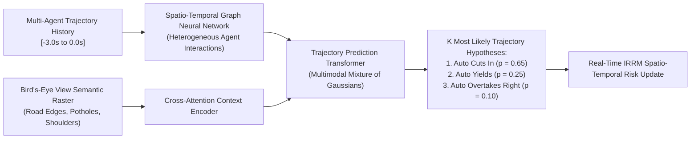
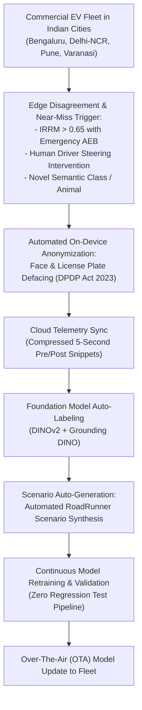

# BharatDrive-AI: Strategic Future Work & R&D Roadmap (2026–2030)

This roadmap outlines the long-term research initiatives, architectural evolutions, and engineering milestones planned for **BharatDrive-AI** to advance autonomous driving on complex, unstructured roads worldwide.

---

## 1. V2X Cooperative Autonomy for Indian Smart Highway Corridors

```mermaid
graph TD
    subgraph V2I ["Vehicle-to-Infrastructure (V2I) - NHAI Smart Corridor"]
        TOLL["FASTag Multi-Lane Free Flow (MLFF)<br/>Gantry Beacon (DSRC 5.9 GHz)"]
        VMS["Dynamic Variable Message Signs (VMS)<br/>Fog, Landslide & Pothole Warning"]
        ROADSIDE["C-V2X Roadside Units (RSUs)<br/>Continuous 3D LiDAR Corridor Feeds"]
    end

    subgraph Ego ["BharatDrive-AI Autonomous Fleet"]
        EGO_VEH["Ego Autonomous Vehicle<br/>(Tata Nexon EV)"]
        COOP_PLANNER["Cooperative Maneuver Planner<br/>(V2X Spatio-Temporal Slot Allocation)"]
    end

    subgraph V2V ["Vehicle-to-Vehicle (V2V) Communication"]
        TRUCK["Commercial Multi-Axle Freight Truck<br/>Broadcasts Blind Spot Cut-In Intent"]
        BUS["Intercity State Transport Bus<br/>Broadcasts Oncoming Overtake Maneuver"]
    end

    ROADSIDE -->|5G NR-V2X Sidelink (PC5)| EGO_VEH
    VMS -->|Corridor Risk Advisory| EGO_VEH
    TOLL -->|Automated High-Speed Gantry Clearance| EGO_VEH
    TRUCK <-->|Direct Low-Latency V2V (< 10 ms)| EGO_VEH
    BUS <-->|Direct Low-Latency V2V (< 10 ms)| EGO_VEH
    EGO_VEH --> COOP_PLANNER
```

### Research Initiatives:
1. **Integration with NHAI National Electronic Toll Collection (NETC / FASTag)**: Automated multi-lane free-flow gantry negotiation at speeds up to 80 km/h without physical barrier stalls.
2. **C-V2X 5G NR Sidelink Communication (3GPP Rel-17/18)**: Peer-to-peer transmission of Basic Safety Messages (BSM) between commercial trucks and passenger AVs, providing non-line-of-sight (NLOS) awareness around blind highway curves.
3. **Cooperative Platoon Formation**: Energy-optimal convoy formation for intercity commercial freight corridors (e.g., Delhi–Mumbai Expressway / NH-44).

---

## 2. Deep Multi-Agent Game-Theoretic Intent Prediction

While the current EKF tracker with linear extrapolation performs reliably within short horizons ($t \le 2.0\text{ s}$), dynamic multi-agent negotiation in crowded bazaars requires anticipating behavioral intent:



### Technical Objectives:
- **Heterogeneous Interaction Graph**: Explicitly models edge interactions between dissimilar traffic participants (e.g., how an auto-rickshaw yields differently to an intercity bus vs. a pedestrian).
- **Multi-Modal Trajectory Hypotheses**: Generates probabilistic future location probability distributions ($K = 6$ modes) with calibrated confidence bounds.
- **Game-Theoretic Policy Optimization**: Implements Level-k thinking models to predict whether an oncoming vehicle will yield or aggressively claim right-of-way at narrow single-lane bottlenecks.

---

## 3. Neuromorphic Event-Based Vision for Severe Weather

Indian monsoon conditions feature torrential rainfall, heavy water splash occlusions, and severe nocturnal headlight glare from oncoming vehicles using non-standard high beams.

```text
CONVENTIONAL FRAME-BASED CAMERA vs. NEUROMORPHIC EVENT CAMERA:
┌──────────────────────────────────────┬──────────────────────────────────────┐
│ Conventional RGB Sensor (IMX390)     │ Prophesee Metavision Event Sensor    │
├──────────────────────────────────────┼──────────────────────────────────────┤
│ Frame Rate: 60 FPS (16.6 ms latency) │ Temporal Resolution: 1 microsecond   │
│ Dynamic Range: 120 dB (Saturates on  │ Dynamic Range: > 140 dB (Immune to   │
│ oncoming 100W halogen high beams)    │ direct high-beam blinding)           │
│ Severe motion blur in rain droplets  │ Asynchronous pixel delta triggers:   │
│ and wiping windshields               │ extracts motion edges through splash │
│ Data Rate: High bandwidth (raw RGB)  │ Data Rate: Sparse, low power (< 10mW)│
└──────────────────────────────────────┴──────────────────────────────────────┘
```

### Integration Plan:
- Co-register an event-based neuromorphic sensor with the front stereo camera.
- Train Spiking Neural Networks (SNNs) for microsecond-level optical flow and obstacle contour detection under zero-visibility rain squalls.

---

## 4. Hardware Quantization & Sub-15W Edge SoC Deployment

To facilitate mass adoption across low-cost commercial vehicles and three-wheelers, the software stack must be optimized for ultra-low power silicon:

1. **INT8 & FP8 Post-Training Quantization (PTQ)**: Compile perception backbones using NVIDIA TensorRT and ARM Ethos-U microNPUs, reducing compute footprint from 20 ms to under 8 ms.
2. **Deterministic FPGA Logic for Stanley Control**: Synthesize the lateral Stanley controller and safety watchdog into VHDL/Verilog on AMD-Xilinx Zynq UltraScale+ MPSoC, achieving sub-millisecond actuation response.
3. **Sub-15W Power Budget**: Enable deployment on battery-electric two-wheelers and three-wheelers without penalizing traction battery range.

---

## 5. Fleet-Scale Active Learning & Edge Curation Engine



### Compliance:
- Full compliance with the **Digital Personal Data Protection (DPDP) Act, 2023 (Government of India)**, guaranteeing all facial features, vehicle registration plates, and personally identifiable geographical markers are stripped at the edge prior to cloud synchronization.

---

## 6. Regulatory Standardization & Automotive Industry Standards (AIS)

- **AIS-140**: Standardized GPS/IRNSS tracking, emergency panic button integration, and continuous telemetry streaming to national emergency response support systems (ERSS - 112).
- **AIS-189**: Advanced Driver Assistance Systems (ADAS) performance requirements for M1 and N1 category commercial vehicles in India.
- **MoRTH Open Data Initiative**: Contributing anonymized multi-agent edge corner-cases to the Ministry of Road Transport and Highways national road safety repository.
