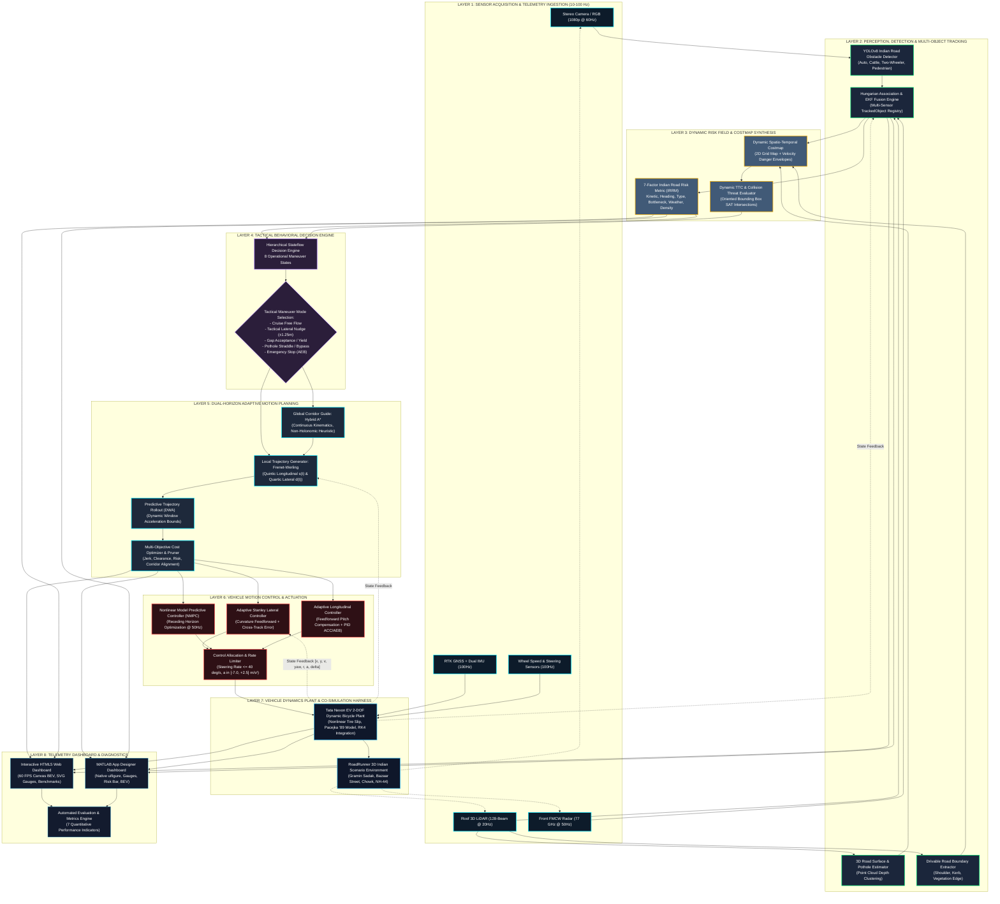

# BharatDrive-AI: Comprehensive System Architecture Specification

## 1. Executive Architecture Overview

**BharatDrive-AI** is architected as an end-to-end, multi-layered autonomous vehicle software stack specifically tailored for non-deterministic, unstructured, and heterogeneous Indian roadway environments. The system achieves closed-loop co-simulation across **MATLAB**, **Simulink**, and **Python**, adhering to **ISO 8855** intermediate vehicle coordinate conventions, **ASAM OpenDRIVE** road network topologies, and **ISO 26262** functional safety design paradigms.



---

## 2. Detailed Subsystem Specifications

### 2.1 Layer 1: Sensor Suite & Ingestion Specifications
The reference ego vehicle platform is instrumented with an automotive sensor suite modeled after modern EV testbeds operating on Indian roads (e.g., Tata Nexon EV, Mahindra XUV400):

| Sensor | Hardware Model / Equivalent | Range & FOV | Update Rate | Interface | Key Telemetry Signals |
|---|---|---|:---:|---|---|
| **Front Stereo Camera** | Sony IMX390 (Automotive Grade) | $120\text{ m}$, $65^\circ\text{ HFOV}$ | $60\text{ Hz}$ | GMSL2 / MIPI-CSI | RGB stream, Bounding boxes, Semantic class, Confidence |
| **Roof 3D LiDAR** | Ouster OS1-128 / RoboSense Ruby | $150\text{ m}$, $360^\circ\times 45^\circ$ | $20\text{ Hz}$ | Automotive Ethernet (1000BASE-T1) | Point cloud $[x, y, z, \text{intensity}, \text{ring}]$, Ground plane, Clusters |
| **Front Radar** | Continental ARS408-21 (77 GHz) | $250\text{ m}$, $\pm 45^\circ$ | $50\text{ Hz}$ | CAN-FD (2 Mbps) | Doppler range, Radial velocity, Azimuth, Target RCS |
| **RTK GNSS / IMU** | OxTS RT3000 / Trimble APX-15 | Global accuracy $< 2\text{ cm}$ | $100\text{ Hz}$ | RS-232 / CAN | Lat/Lon, Heading ($\theta$), Acceleration ($a_x, a_y$), Angular velocity ($\omega_z$) |
| **Chassis Sensors** | OEM CAN Gateway (Tata Nexon EV) | Wheel rotation $\pm 0.1\text{ km/h}$ | $100\text{ Hz}$ | High-Speed CAN (500 kbps) | Wheel speeds, Steering wheel angle ($\delta_{sw}$), Brake pedal pressure |

---

### 2.2 Layer 2: Perception & Multi-Object Tracking Engine
- **Obstacle Detection Engine**:
  - Deep convolutional / transformer detector fine-tuned on the **Indian Driving Dataset (IDD)**.
  - Detects heterogeneous classes: `Cattle` (Cow, Buffalo, Calf), `Auto-Rickshaw` (3-wheelers), `Two-Wheeler` (Motorcycles, Scooters, Bicycles), `Heavy Commercial Vehicle` (Tata 407, Ashok Leyland buses), `Pedestrian`, and `Road Hazard` (Potholes, non-standard speed breakers, barricades).
- **Hungarian Tracking & Extended Kalman Filter (EKF)**:
  - State vector per tracked entity: $\mathbf{x}_{\text{track}} = [x, y, v_x, v_y, \text{length}, \text{width}, \theta]^T$.
  - Measurement gating: Mahalanobis distance with covariance threshold $\chi^2_{0.95} = 9.488$ ($4$ degrees of freedom).
  - Track Lifecycle Manager: 3-hit confirmation for promotion to active track; 5-frame coastal prediction before track deletion.

---

### 2.3 Layer 3: Dynamic Risk Assessment & Costmap Synthesis
- **7-Factor Indian Road Risk Metric (IRRM)**:
  $$\text{IRRM} = \sum_{i=1}^7 w_i \cdot \phi_i$$
  Where each factor $\phi_i \in [0, 1]$ models a distinct Indian traffic phenomenon:
  1. $\phi_1$ **Kinetic Threat**: Inverse Time-to-Collision ($\text{TTC}^{-1}$) and closing velocity $v_{\text{rel}}$.
  2. $\phi_2$ **Approach Heading**: Angular alignment $\Delta \theta = |\theta_{\text{ego}} - \theta_{\text{obs}}|$, detecting head-on collision risks in undivided single-lane corridors.
  3. $\phi_3$ **Obstacle Vulnerability**: Class severity weight (Cattle $= 2.2$, Pedestrian $= 2.5$, Bus $= 2.0$, Auto $= 1.4$).
  4. $\phi_4$ **Road Width Bottleneck**: Drivable corridor constriction factor ($\frac{W_{\text{nominal}} - W_{\text{avail}}}{W_{\text{nominal}}}$).
  5. $\phi_5$ **Surface Friction & Visibility**: Road friction coefficient $\mu \in [0.35, 0.85]$ and camera transmission loss in monsoon rain/fog.
  6. $\phi_6$ **Multi-Agent Traffic Density**: Spatial cluster density of surrounding filtering two-wheelers and pedestrians within a 25 m neighborhood.
  7. $\phi_7$ **Blind Crest / Occlusion**: Unseen region hazard field based on line-of-sight raycasting.

---

### 2.4 Layer 4: Tactical Decision Engine (Stateflow)
The vehicle state transitions through an 8-state deterministic finite state machine (FSM):
1. **Cruise Free Flow**: Standard lane/corridor tracking at target velocity ($50\text{ km/h}$).
2. **Follow Lead Vehicle**: Adaptive longitudinal spacing behind leading traffic ($t_{\text{gap}} = 1.8\text{ s}$).
3. **Tactical Nudge Left**: Off-center curvilinear offset ($d_{\text{target}} = +1.25\text{ m}$) to bypass a stationary obstacle while remaining on paved road.
4. **Tactical Nudge Right**: Off-center curvilinear offset ($d_{\text{target}} = -1.25\text{ m}$).
5. **Yield / Gap Acceptance**: Deceleration to allow oncoming commercial traffic or cross-junction traffic to clear tight choke points.
6. **Pothole Straddle / Avoidance**: Minor trajectory perturbation to place road surface depressions between the left and right tire tracks.
7. **Braking / Deceleration**: Controlled deceleration ($a = -2.5\text{ m/s}^2$) for high-risk dynamic cut-ins.
8. **Emergency Braking (AEB)**: Maximum deceleration ($a = -7.0\text{ m/s}^2$) triggered when $\text{TTC} < 1.4\text{ s}$.

---

### 2.5 Layer 5: Dual-Horizon Motion Planning
- **Global Corridor Search (Hybrid A*)**:
  - Kinematically feasible trajectory search using the 2-DOF bicycle model with 6 discrete steering angles $[-30^\circ, -15^\circ, 0^\circ, +15^\circ, +30^\circ]$ and forward/reverse primitives.
  - Heuristic combining non-holonomic Reeds-Shepp distance without obstacles and 2D dynamic distance transform with obstacle clearance.
- **Local Trajectory Optimization (Frenet-Werling Polynomials)**:
  - Longitudinal trajectory: Quintic polynomial $s(t) = a_0 + a_1 t + a_2 t^2 + a_3 t^3 + a_4 t^4 + a_5 t^5$.
  - Lateral trajectory: Quartic/Quintic polynomial $d(t) = b_0 + b_1 t + b_2 t^2 + b_3 t^3 + b_4 t^4 + b_5 t^5$.
  - Cost Function:
    $$J = w_j \int (\dddot{s}^2 + \dddot{d}^2) dt + w_t T + w_v (v - v_{\text{target}})^2 + w_d d^2 + w_{\text{coll}} J_{\text{obstacle}}$$

---

### 2.6 Layer 6: Motion Control & Actuation
- **Lateral Path Tracking (Adaptive Stanley Controller)**:
  $$\delta(t) = \theta_e(t) + \arctan\left(\frac{k \cdot e_{fa}(t)}{v(t) + \epsilon}\right) + \delta_{\text{feedforward}}(\kappa(s))$$
  Where $e_{fa}$ is the lateral cross-track error at the front axle, $\theta_e$ is heading error relative to spline tangent, and $\kappa(s)$ is spline road curvature.
- **Longitudinal Speed Control**:
  - Feedforward road slope compensation combined with PI tracking on longitudinal acceleration:
    $$a_{\text{cmd}} = k_p (v_{\text{target}} - v) + k_i \int (v_{\text{target}} - v) dt + g \cdot \sin(\theta_{\text{road}})$$

---

### 2.7 Layer 7: Tata Nexon EV Plant Model Specifications

| Parameter | Symbol | Value | Unit | Description |
|---|:---:|:---:|:---:|---|
| **Total Vehicle Mass** | $m$ | $1400.0$ | $\text{kg}$ | Curb weight + driver & instrument package |
| **Wheelbase** | $L$ | $2.498$ | $\text{m}$ | Distance between front and rear axles |
| **Front Axle to CG** | $l_f$ | $1.200$ | $\text{m}$ | Center of gravity location |
| **Rear Axle to CG** | $l_r$ | $1.298$ | $\text{m}$ | Center of gravity location |
| **Vehicle Total Length** | $L_{\text{veh}}$ | $3.993$ | $\text{m}$ | Bumper-to-bumper length |
| **Vehicle Width** | $W_{\text{veh}}$ | $1.811$ | $\text{m}$ | Overall width excluding mirrors |
| **Yaw Moment of Inertia** | $I_z$ | $2100.0$ | $\text{kg}\cdot\text{m}^2$ | Rotational inertia about z-axis |
| **Front Tire Cornering Stiffness** | $C_{af}$ | $65000.0$ | $\text{N/rad}$ | Saturated cornering stiffness |
| **Rear Tire Cornering Stiffness** | $C_{ar}$ | $60000.0$ | $\text{N/rad}$ | Saturated cornering stiffness |
| **Max Steering Angle** | $\delta_{\max}$ | $35.0$ | $\text{deg}$ | Wheel road angle limit |
| **Max Steering Rate** | $\dot{\delta}_{\max}$ | $40.0$ | $\text{deg/s}$ | Electric Power Steering (EPS) slew limit |
| **Max Service Deceleration** | $a_{\min}$ | $-7.0$ | $\text{m/s}^2$ | Full hydraulic friction + regenerative braking |

---

## 3. Data Bus Signal Dictionary

All inter-module communication is formalized via Simulink Buses and ROS 2 Message structures:

```text
BharatDrive_Bus/
├── EgoStateBus (100 Hz)
│   ├── time               : double (s)
│   ├── position           : double[3] (x, y, z in meters)
│   ├── velocity           : double[3] (vx, vy, vz in m/s)
│   ├── orientation        : double[3] (roll, pitch, yaw in rad)
│   ├── angular_rates      : double[3] (p, q, r in rad/s)
│   ├── accelerations      : double[3] (ax, ay, az in m/s^2)
│   └── steering_angle     : double (rad)
├── PerceptionBus (20 Hz)
│   ├── num_objects        : uint32
│   ├── tracked_objects    : TrackedObject[32]
│   │   ├── id             : uint32
│   │   ├── class_id       : uint8 (0:Ped, 1:2W, 2:Auto, 3:Car, 4:Truck, 5:Cattle, 6:Pothole)
│   │   ├── position       : double[3] (x, y, z)
│   │   ├── velocity       : double[3] (vx, vy, vz)
│   │   ├── dimensions     : double[3] (length, width, height)
│   │   ├── heading        : double (yaw)
│   │   ├── confidence     : double [0.0 - 1.0]
│   │   └── sensors_fused  : uint8 (bitmask: bit 0: CAM, bit 1: LIDAR, bit 2: RADAR)
│   └── drivable_corridor  : CorridorBoundary[64]
├── RiskAssessmentBus (20 Hz)
│   ├── composite_irrm     : double [0.0 - 1.0]
│   ├── criticality_zone   : uint8 (0:SAFE, 1:CAUTION, 2:WARNING, 3:CRITICAL)
│   ├── ttc_minimum        : double (s)
│   ├── primary_threat_id  : uint32
│   └── factor_breakdown   : double[7]
├── DecisionBus (20 Hz)
│   ├── maneuver_state     : uint8 (1:CRUISE, 2:NUDGE_L, 3:NUDGE_R, 4:YIELD, 5:STOP, ...)
│   ├── target_lane_offset : double (meters, e.g. +1.25m or -1.25m)
│   └── target_velocity    : double (m/s)
├── TrajectoryPlanBus (20 Hz)
│   ├── trajectory_points  : TrajectoryPoint[100]
│   │   ├── x, y, z        : double (m)
│   │   ├── s, d           : double (Frenet coordinates)
│   │   ├── velocity       : double (m/s)
│   │   ├── acceleration   : double (m/s^2)
│   │   ├── yaw            : double (rad)
│   │   ├── curvature      : double (1/m)
│   │   └── target_time    : double (s)
│   ├── replan_latency_ms  : double (ms)
│   └── replan_success     : boolean
└── ControlCommandBus (50 Hz)
    ├── steering_cmd_rad   : double (rad)
    ├── throttle_cmd       : double [0.0 - 1.0]
    ├── brake_pressure_bar : double [0.0 - 150.0 bar]
    └── aeb_active         : boolean
```
