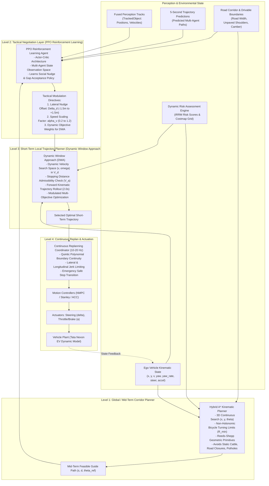

# Adaptive Path Planning Architecture: Hybrid A* + DWA + PPO Reinforcement Learning
**BharatDrive-AI — MathWorks Autonomous Driving Hackathon**

---

## 1. System Architecture Diagram

---

## 2. Theoretical Formulation & Tri-Hybrid Synergy

### 1. Hybrid A* (Kinematic Corridor Feasibility)
Standard grid A* searches discrete cells, producing jagged non-drivable paths that violate vehicle turning radiuses. **Hybrid A\*** searches in continuous 3D coordinate space $(x, y, \theta)$ with discrete cell hashing:
- **Motion Primitives**: Front-wheel steered kinematic bicycle arcs with curvature $\kappa \in [-\kappa_{max}, \kappa_{max}]$ where $\kappa_{max} = \frac{\tan(\delta_{max})}{L} = 0.22\text{ m}^{-1}$ ($R_{min} = 4.54\text{ m}$).
- **Heuristic Function $h(n)$**:
  $$h(n) = \max\left(h_{ReedsShepp}(n, n_{goal}), \; h_{2D\_Dijkstra}(n, n_{goal})\right)$$
  Where $h_{ReedsShepp}$ accounts for non-holonomic turning without obstacles, and $h_{2D\_Dijkstra}$ accounts for road boundaries and static blockages.
- **Output**: Mid-term collision-free reference corridor waypoints $[x_{ref}(s), y_{ref}(s), \theta_{ref}(s)]$.

---

### 2. PPO Reinforcement Learning (Tactical Negotiation Policy)
Indian traffic is continuous, non-lane-based negotiation. A rule-based planner cannot anticipate whether an aggressive auto-rickshaw will yield or push into a gap.
- **Observation Space $S_t \in \mathbb{R}^{24}$**:
  - Ego state: $v_{ego}, a_{ego}, \delta_{ego}, \kappa_{road}$.
  - Context: $W_{road}, \mu_{friction}, \nu_{visibility}, \rho_{traffic}$.
  - Top-3 surrounding dynamic obstacles: $[d_j, v_{rel,j}, \theta_{approach,j}, \text{Class}_j, \mathcal{R}_j]_{j=1}^3$.
  - Reference corridor error: lateral offset $e_d$, heading error $e_\theta$.
- **Action Space $A_t \in \mathbb{R}^3$ (Continuous Gaussian Actor)**:
  - $a_1 = \Delta d_{nudge} \in [-1.5\text{ m}, +1.5\text{ m}]$: Tactical lateral displacement within the corridor (e.g. nudging left to clear an oncoming bus or overtaking a cycle).
  - $a_2 = \alpha_v \in [0.2, 1.2]$: Target speed scaling factor.
  - $a_3 = w_{risk\_bias} \in [0.5, 3.0]$: Dynamic risk aversion weight.
- **Reward Function**:
  $$R_t = r_{progress} - w_c \cdot \mathcal{R}_{IRRM} - w_{jerk} (j_{lon}^2 + j_{lat}^2) - w_{boundary} \cdot \mathbb{I}_{offroad} + r_{courteous\_yield}$$

---

### 3. Dynamic Window Approach (DWA) (High-Speed Local Optimization)
DWA operates directly in vehicle control space $(v, \omega)$, evaluating forward kinematic rollouts over a $2.0\text{ s}$ horizon at $10\text{--}20\text{ Hz}$:
- **Dynamic Window $V_d$**: Limits velocity and yaw rate to what is physically reachable within time step $\Delta t$ under powertrain acceleration and steering actuator constraints:
  $$V_d = \left\{ (v, \omega) \;\middle|\; \begin{aligned} v &\in [v_c - a_{decel} \Delta t, \; v_c + a_{accel} \Delta t] \cap [0, v_{max}] \\ \omega &\in [\omega_c - \dot{\omega}_{max} \Delta t, \; \omega_c + \dot{\omega}_{max} \Delta t] \cap [-\omega_{max}, \omega_{max}] \end{aligned} \right\}$$
- **Admissible Velocities $V_a$ (Guaranteed Stopping)**:
  $$V_a = \left\{ (v, \omega) \;\middle|\; v \le \sqrt{2 \cdot \text{dist}_{clearance}(v, \omega) \cdot a_{decel}^{max}} \right\}$$
- **Modulated Objective Function (Maximized over $(v, \omega) \in V_d \cap V_a$)**:
  $$G(v, \omega) = w_1 \cdot \text{heading}(v, \omega, \theta_{target}) + w_2 \cdot \text{clearance}(v, \omega) + w_3 \cdot \text{velocity}(v, \omega) - w_{risk\_PPO} \cdot \text{Cost}_{IRRM}(v, \omega)$$
  The weights $w_1, w_2, w_3, w_{risk\_PPO}$ and target heading $\theta_{target}$ are dynamically steered by the PPO tactical directives!

---

### 4. Continuous Replanning Loop
Every $100\text{ ms}$ ($\Delta t = 0.1\text{ s}$):
1. Receive updated fused tracks and 5-second trajectory forecasts.
2. Update the dynamic spatio-temporal costmap.
3. The PPO agent updates tactical nudge and risk aversion weights.
4. DWA samples achievable $(v, \omega)$ and selects the optimal path.
5. If an unavoidable obstacle suddenly enters the clearance zone (e.g. calf sprints or auto-rickshaw cuts in), DWA automatically collapses $V_a$ to zero velocity, invoking Emergency Brake Assist (AEB).
