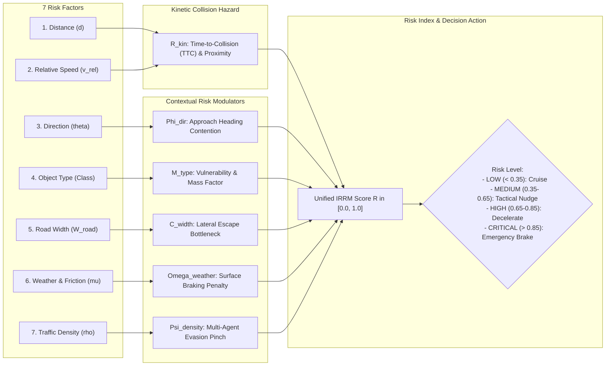

# Mathematical Dynamic Risk Assessment Formulation for Unstructured Indian Roads
**BharatDrive-AI — MathWorks Autonomous Driving Hackathon**

---

## 1. Executive Summary & Problem Context

On unstructured Indian roads, standard highway risk formulations (such as basic Time-to-Collision $TTC = d / v_{rel}$) fail because:
1. **Pinch Points & Lateral Bottlenecks**: On narrow rural or market roads ($W_{road} = 3.75\text{--}4.5\text{ m}$), an obstacle blocks not just its own footprint, but the entire lateral escape corridor.
2. **Heterogeneous Road User Vulnerability**: Colliding with a $450\text{ kg}$ bovine or an unprotected pedestrian has fundamentally different consequences than grazing a low-speed hatchback bumper.
3. **Severe Weather & Surface Degradation**: Monsoon rains and unpaved shoulders cut tire-road friction $\mu$ from $0.85$ down to $0.40$, dramatically extending the vehicle's minimum stopping distance.
4. **Multi-Agent Spatial Crowding**: An obstacle directly ahead becomes substantially more hazardous if adjacent two-wheelers and pedestrians prevent lateral evasion.

The **Indian Road Risk Metric (IRRM)** dynamically integrates all **7 physical and contextual dimensions** into a normalized continuous risk score $\mathcal{R}(t) \in [0.0, 1.0]$.

---

## 2. Mathematical Formulation of the Unified Risk Index

The total instantaneous risk $\mathcal{R}_i(t)$ associated with obstacle $i$ is formulated as a product of baseline kinetic hazard and contextual amplification multipliers:

$$\mathcal{R}_i(t) = \min\left(1.0, \; \mathcal{R}_{kin}(d_i, v_{rel,i}) \cdot \Phi_{dir}(\theta_{app,i}) \cdot \mathcal{M}_{type}(c_i) \cdot \mathcal{C}_{width}(W_{road}) \cdot \Omega_{weather}(\mu, \nu) \cdot \Psi_{density}(\rho_{traffic})\right)$$

---

## 3. Sub-Component Formulations

### Dimension 1 & 2: Distance ($d$) & Relative Speed ($v_{rel}$)
Kinetic collision risk is derived from the **Time-to-Collision (TTC)** $\tau = \frac{d}{\max(v_{rel}, \epsilon)}$ combined with a spatial proximity envelope:

$$\mathcal{R}_{kin}(d, v_{rel}) = w_1 \exp\left(-\frac{\tau}{\tau_0}\right) + w_2 \exp\left(-\frac{d}{d_{safe}(v_{ego})}\right)$$

Where:
- $\tau_0 = 3.5\text{ seconds}$ (critical time horizon threshold).
- $d_{safe}(v_{ego}) = d_0 + v_{ego} \cdot t_{react} + \frac{v_{ego}^2}{2 a_{comfort}}$ is the safe following distance ($d_0 = 3.0\text{ m}, t_{react} = 1.0\text{ s}, a_{comfort} = 2.5\text{ m/s}^2$).
- $w_1 = 0.65, w_2 = 0.35$.
- If $v_{rel} \le 0$ (obstacle moving away or matching speed), $\tau \rightarrow \infty$, and risk is governed solely by physical proximity $d$.

---

### Dimension 3: Direction ($\theta_{approach}$)
The directional factor $\Phi_{dir}$ penalizes trajectories moving toward the ego path:
$$\Phi_{dir}(\theta_{approach}) = 1.0 + \gamma_{dir} \cdot \max\left(0, \; -\cos(\theta_{approach})\right) + \gamma_{cut} \cdot |\sin(\theta_{approach})|$$

Where $\theta_{approach}$ is the angle between the obstacle's velocity vector and the relative line-of-sight vector to the ego vehicle:
- **Head-On Oncoming ($\theta \approx 180^\circ$, e.g. Oncoming Bus)**: $\cos(180^\circ) = -1 \implies \Phi_{dir} = 1.0 + \gamma_{dir} \cdot 1.0 = 1.60$ ($60\%$ amplification due to combined kinetic closing energy).
- **Perpendicular Cut-In ($\theta \approx \pm 90^\circ$, e.g. Auto-Rickshaw, Crossing Cow/Pedestrian)**: $|\sin(\pm 90^\circ)| = 1.0 \implies \Phi_{dir} = 1.0 + \gamma_{cut} = 1.45$ (high lateral unpredictability).
- **Parallel Lead Vehicle ($\theta \approx 0^\circ$)**: $\Phi_{dir} = 1.00$ (baseline).
- Parameter settings: $\gamma_{dir} = 0.60, \gamma_{cut} = 0.45$.

---

### Dimension 4: Object Type Vulnerability & Severity ($\mathcal{M}_{type}$)
Reflects both the physical injury vulnerability of the agent (Vulnerable Road Users) and structural damage severity to the ego EV:

$$\mathcal{M}_{type}(c) = \begin{cases} 
2.50 & \text{Pedestrian (zero armor, critical injury risk)} \\
2.20 & \text{Cattle / Cow (450 kg dense biological mass, windshield penetration)} \\
2.00 & \text{Two-Wheeler / Cycle (high wobble, filtering between lanes)} \\
1.80 & \text{Auto-Rickshaw (3-wheeler, tight turning radius, open cabin)} \\
2.40 & \text{Commercial Bus / Heavy Truck (massive kinetic mass, high severity to ego)} \\
1.60 & \text{Pothole / Road Hazard (suspension rupture, rim crack, loss of control)} \\
1.00 & \text{Passenger Car (standard crashworthy reference)}
\end{cases}$$

---

### Dimension 5: Road Width & Lateral Escape Bottleneck ($\mathcal{C}_{width}$)
When road width narrows, the ego vehicle's ability to execute a collision-avoidance lateral swerve collapses. The constraint factor models lateral space restriction:

$$\mathcal{C}_{width}(W_{road}) = \left(\frac{W_{nominal}}{W_{road}}\right)^{1.4}$$

Where $W_{nominal} = 7.00\text{ m}$ (standard two-lane undivided highway):
- **4-Lane Divided Highway ($W = 14.0\text{ m}$)**: $\mathcal{C}_{width} = (7.0/14.0)^{1.4} = 0.38$ (ample lateral escape corridor).
- **Standard 2-Lane Road ($W = 7.0\text{ m}$)**: $\mathcal{C}_{width} = 1.00$ (nominal reference).
- **Intermediate Lane ($W = 5.5\text{ m}$)**: $\mathcal{C}_{width} = (7.0/5.5)^{1.4} = 1.40$ ($40\%$ risk amplification).
- **Single-Lane Village Road / Constrained Market ($W = 3.75\text{ m}$)**: $\mathcal{C}_{width} = (7.0/3.75)^{1.4} = 2.41$ (**$141\%$ amplification! Zero escape clearance without dropping into ditch**).

---

### Dimension 6: Weather, Road Friction & Visibility ($\Omega_{weather}$)
Required emergency stopping distance scales inversely with the tire-road friction coefficient $\mu$:
$$d_{stop} = \frac{v_{ego}^2}{2 \mu g}$$

The weather multiplier is defined as:
$$\Omega_{weather}(\mu, \nu) = \left(\frac{\mu_{dry}}{\max(0.20, \mu)}\right)^{0.85} \cdot (1.0 + \kappa_{vis} \cdot (1.0 - \nu))$$

Where:
- $\mu_{dry} = 0.85$ (dry clean asphalt).
- $\mu$: Current road surface friction ($\mu = 0.85$ dry asphalt, $\mu = 0.50$ monsoon wet, $\mu = 0.35$ agricultural mud tracks).
- $\nu \in [0.0, 1.0]$: Atmospheric visibility index ($\nu = 1.0$ clear daylight, $\nu = 0.40$ dense dust storm / heavy rain).
- $\kappa_{vis} = 0.35$.
- *Example*: In heavy monsoon rain on wet asphalt ($\mu = 0.50, \nu = 0.60$):
  $$\Omega_{weather} = (0.85 / 0.50)^{0.85} \cdot (1.0 + 0.35 \cdot 0.40) = 1.57 \cdot 1.14 = 1.79 \quad \mathbf{(79\%\text{ increase in total risk!})}$$

---

### Dimension 7: Traffic Density & Multi-Agent Pinch Factor ($\Psi_{density}$)
Quantifies the density of secondary obstacles in the immediate vicinity ($r \le 25\text{ m}$) that restrict lateral and longitudinal evasive maneuvers:

$$\Psi_{density}(\rho_{traffic}) = 1.0 + \beta_{dense} \cdot \sum_{j \ne i} \exp\left(-\frac{\|\mathbf{p}_i - \mathbf{p}_j\|^2}{2 \sigma_{dense}^2}\right)$$

Where:
- $\sigma_{dense} = 10.0\text{ m}$.
- $\beta_{dense} = 0.15$.
- If an auto-rickshaw is isolated on an open road, $\Psi_{density} = 1.00$.
- In a crowded market with 4 surrounding two-wheelers and pedestrians, $\Psi_{density} \approx 1.45$ ($45\%$ increase due to lack of an escape path).

---

## 4. Decision Actions by Criticality Zone

| IRRM Score $\mathcal{R}$ | Criticality Zone | Alert Level | Autonomous Driving Tactical Action |
| :--- | :--- | :--- | :--- |
| $\mathcal{R} < 0.35$ | **LOW** | Green | Maintain nominal cruise speed and corridor tracking. |
| $0.35 \le \mathcal{R} < 0.65$ | **MEDIUM** | Yellow | **Tactical Nudge**: Initiate lateral bias within lane to maintain $1.5\text{ m}$ clearance; feather throttle. |
| $0.65 \le \mathcal{R} < 0.85$ | **HIGH** | Orange | **Active Deceleration**: Decelerate at $1.5\text{--}2.5\text{ m/s}^2$; yield right-of-way if cut-in is aggressive. |
| $\mathcal{R} \ge 0.85$ | **CRITICAL** | Red | **Emergency Brake Assist (AEB)**: Apply maximum braking ($-6.5\text{ m/s}^2$) + emergency steering evasion if clear. |
