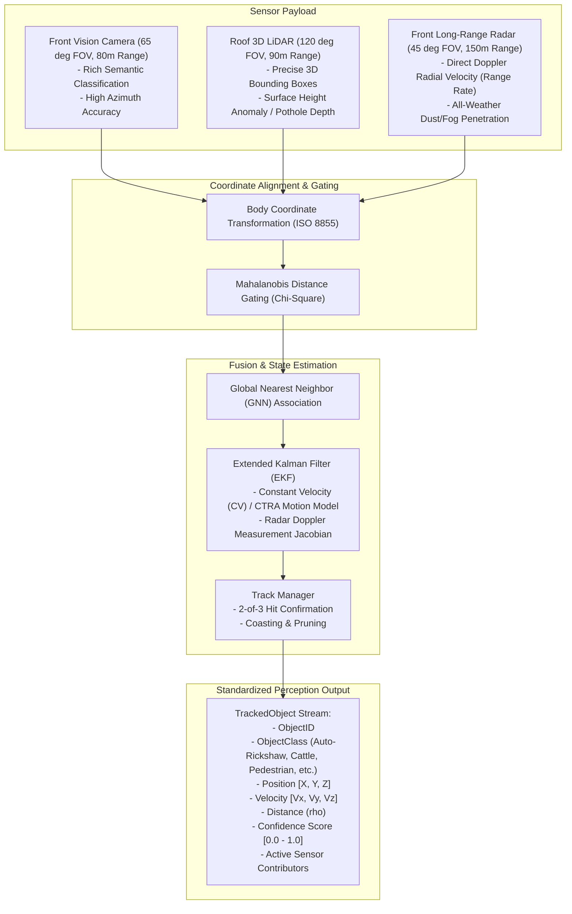

# Perception & Multi-Sensor Fusion Specification
**BharatDrive-AI — MathWorks Autonomous Driving Hackathon**

---

## 1. System Architecture

The perception pipeline integrates three complementary sensor modalities to ensure robust object detection and dynamic tracking in dense, unstructured Indian road environments:

---

## 2. Sensor Modality Specifications & Noise Models

| Modality | Mounting Position (m) | Field of View | Operational Range | Measurement Vector $\mathbf{z}$ | Measurement Noise Covariance $\mathbf{R}$ |
| :--- | :--- | :--- | :--- | :--- | :--- |
| **Camera** | Windshield $[2.0, 0.0, 1.45]$ | $65^\circ$ Horizontal | $1.0\text{--}80.0\text{ m}$ | $[x_{cam}, y_{cam}, z_{cam}]^T$ | $\text{diag}\left(\max(0.5, 0.04x)^2, 0.15^2, 0.20^2\right)$ |
| **LiDAR** | Roof $[1.4, 0.0, 1.75]$ | $120^\circ$ Horizontal | $0.5\text{--}90.0\text{ m}$ | $[x_{lid}, y_{lid}, z_{lid}]^T$ | $\text{diag}\left(0.06^2, 0.06^2, 0.03^2\right)$ |
| **Radar** | Front Bumper $[3.4, 0.0, 0.45]$| $45^\circ$ Horizontal | $1.5\text{--}150.0\text{ m}$ | $[x_{rad}, y_{rad}, \dot{\rho}]^T$ | $\text{diag}\left(0.25^2, 0.70^2, 0.15^2\right)$ |

---

## 3. Mathematical Derivations

### A. Extended Kalman Filter (EKF) State Vector
The state vector for each tracked target is formulated in the ego vehicle body frame ($+X$ forward, $+Y$ left):
$$\mathbf{x} = \begin{bmatrix} x \\ y \\ v_x \\ v_y \end{bmatrix}$$

State transition matrix under Constant Velocity (CV) model:
$$\mathbf{F} = \begin{bmatrix} 1 & 0 & \Delta t & 0 \\ 0 & 1 & 0 & \Delta t \\ 0 & 0 & 1 & 0 \\ 0 & 0 & 0 & 1 \end{bmatrix}$$

Process noise covariance:
$$\mathbf{Q} = \begin{bmatrix} \sigma_{pos}^2 & 0 & 0 & 0 \\ 0 & \sigma_{pos}^2 & 0 & 0 \\ 0 & 0 & \sigma_{vel}^2 & 0 \\ 0 & 0 & 0 & \sigma_{vel}^2 \end{bmatrix} \Delta t$$
Where $\sigma_{pos} = 0.15\text{ m}$ and $\sigma_{vel} = 1.20\text{ m/s}$.

### B. Non-Linear Radar Doppler Measurement Model & Jacobian
Radar measures position $(x, y)$ along with Doppler radial velocity $\dot{\rho}$:
$$h_{radar}(\mathbf{x}) = \begin{bmatrix} x \\ y \\ \frac{x v_x + y v_y}{\sqrt{x^2 + y^2}} \end{bmatrix}$$

Let range $\rho = \sqrt{x^2 + y^2}$. The partial derivatives of radial velocity are:
$$\frac{\partial \dot{\rho}}{\partial x} = \frac{y^2 v_x - x y v_y}{\rho^3}, \quad \frac{\partial \dot{\rho}}{\partial y} = \frac{x^2 v_y - x y v_x}{\rho^3}$$
$$\frac{\partial \dot{\rho}}{\partial v_x} = \frac{x}{\rho}, \quad \frac{\partial \dot{\rho}}{\partial v_y} = \frac{y}{\rho}$$

Linearized observation Jacobian $\mathbf{H}_{radar}$:
$$\mathbf{H}_{radar} = \begin{bmatrix} 1 & 0 & 0 & 0 \\ 0 & 1 & 0 & 0 \\ \frac{\partial \dot{\rho}}{\partial x} & \frac{\partial \dot{\rho}}{\partial y} & \frac{x}{\rho} & \frac{y}{\rho} \end{bmatrix}$$

### C. Fused Confidence Score Formulation
Confidence is dynamically synthesized from measurement consistency, covariance certainty, and multi-sensor synergy:
$$\text{Confidence} = \text{clip}\left(0.50 \cdot \frac{\text{Hits}}{\text{Age}} + 0.10 \cdot N_{sensors} + \frac{0.20}{1.0 + \text{Tr}(\mathbf{P}_{pos})}, \, 0.20, \, 0.99\right)$$
- If a target is confirmed by both Camera and Radar, confidence jumps above $0.90$.
- If a target is coasted (no sensor updates), confidence decays gracefully until deletion.
