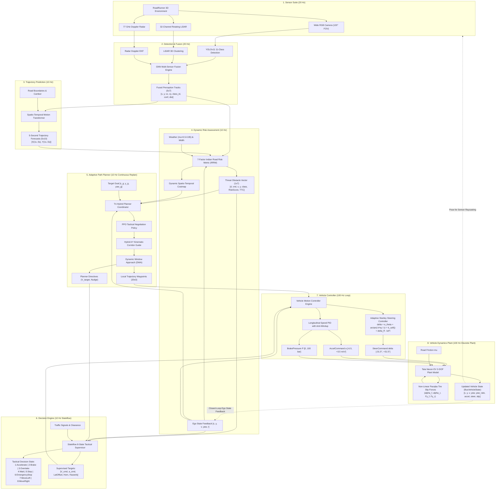

# Complete End-to-End Autonomous Driving Architecture
**BharatDrive-AI — MathWorks Autonomous Driving Hackathon**

---

## 1. Master System Block Diagram

---

## 2. Comprehensive Connection & Signal Line Specification

The table below explains **every single signal connection** in the master Simulink model:

| # | Source Subsystem & Port | Destination Subsystem & Port | Signal / Bus Name | Data Type & Dimensions | Units | Physical & Mathematical Explanation |
|---|---|---|---|---|---|---|
| **C1** | `1_Sensor_Suite/1` | `2_Detection_and_Fusion/1` | `CameraDetections` | `double [5 x 5]` | pixels / m | Normalized bounding boxes $[u, v, w, h]$ and YOLO class predictions for up to 5 detected objects. |
| **C2** | `1_Sensor_Suite/2` | `2_Detection_and_Fusion/2` | `LiDARClusters` | `double [5 x 4]` | m, counts | Clustered 3D point cloud centroids $[x_{rel}, y_{rel}, z_{rel}]$ and return intensity for spatial ground-truth localization. |
| **C3** | `1_Sensor_Suite/3` | `2_Detection_and_Fusion/3` | `RadarTargets` | `double [5 x 4]` | m, m/s, deg, dB | Direct Doppler radar measurements $[r, \dot{r}, \phi, \text{RCS}]$ providing instantaneous range rate and velocity. |
| **C4** | `2_Detection_and_Fusion/1` | `3_Trajectory_Prediction/1` | `FusedTracks` | `double [5 x 7]` | m, m/s, ID, % | Fused obstacle states: $[x, y, v_x, v_y, \text{class\_id}, \text{confidence}, \text{distance}]$ from Camera-LiDAR-Radar EKF fusion. |
| **C5** | `2_Detection_and_Fusion/1` | `4_Risk_Assessment/1` | `FusedTracks` | `double [5 x 7]` | m, m/s | Feeds current obstacle positions and velocities into the 7-factor IRRM risk evaluation engine. |
| **C6** | `3_Trajectory_Prediction/1` | `4_Risk_Assessment/2` | `PredictedTrajectories` | `double [5 x 10]` | m | 5-second multi-agent trajectory forecasts $[X(1s..5s), Y(1s..5s)]$ enabling predictive time-to-collision and spatial corridor risk mapping. |
| **C7** | `4_Risk_Assessment/1` | `5_Path_Planner/3` | `ThreatObstacle` | `double [1 x 7]` | m, m/s, ID, score, s | Primary threat vector $[d_{threat}, v_{rel}, x, y, \text{class}, \mathcal{R}_{score}, TTC]$. Signals PPO for tactical lateral nudging. |
| **C8** | `4_Risk_Assessment/1` | `6_Decision_Engine/3` | `ThreatObstacle` | `double [1 x 7]` | m, m/s, score, s | Evaluated by Stateflow for priority transitions: triggers `Emergency Stop` if $TTC \le 1.1\text{ s}$ or $\mathcal{R} \ge 0.88$; triggers `Wait` for cattle. |
| **C9** | `5_Path_Planner/1` | `7_Vehicle_Controller/3` | `LocalTrajectoryWaypoints` | `double [20 x 3]` | m, rad | Reference path waypoints $[x_{ref}, y_{ref}, \theta_{ref}]$ computed by Hybrid A* and DWA with PPO tactical nudge for Stanley tracking. |
| **C10** | `5_Path_Planner/2` | `6_Decision_Engine/2` | `PlannerVelocity` | `double [1 x 1]` | m/s | Nominal velocity proposal from DWA continuous replanning, subject to Stateflow tactical supervisor confirmation. |
| **C11** | `6_Decision_Engine/1` | `7_Vehicle_Controller/2` | `DecisionCommandBus` | `Bus: BusDecisionOutput` | m/s, m/s², m, bool | Stateflow tactical directives: `[State, TargetSpeed, TargetAccel, TargetLateralOffset, Horn, HazardLights]`. |
| **C12** | `7_Vehicle_Controller/1` | `8_Vehicle_Dynamics/1` | `ControlCommandBus` | `Bus: BusControlCommand` | rad, m/s², bar | Low-level actuator signals: `SteerCommand` ($\delta$), `AccelCommand` ($a$), and `BrakePressure` ($P$) feeding Tata Nexon EV powertrain and brakes. |
| **C13** | `8_Vehicle_Dynamics/1` | `1_Sensor_Suite/1` | `EgoVehicleState` (Feedback) | `Bus: BusVehicleState` | m, m/s, rad, rad/s | Closed-loop vehicle pose and velocity feedback for sensor raycasting and coordinate frame transforms. |
| **C14** | `8_Vehicle_Dynamics/1` | `4_Risk_Assessment/3` | `EgoVehicleState` (Feedback) | `Bus: BusVehicleState` | m/s, rad/s | Real-time vehicle speed and heading for exact time-to-collision and dynamic approach angle calculation. |
| **C15** | `8_Vehicle_Dynamics/1` | `5_Path_Planner/1` | `EgoVehicleState` (Feedback) | `Bus: BusVehicleState` | m, m/s, rad | Starting origin state for continuous Hybrid A* search and DWA velocity window $(V_d)$ formulation. |
| **C16** | `8_Vehicle_Dynamics/1` | `6_Decision_Engine/1` | `EgoVehicleState` (Feedback) | `Bus: BusVehicleState` | m/s | Velocity feedback for zero-speed confirmation in `Wait` and `Stop` states. |
| **C17** | `8_Vehicle_Dynamics/1` | `7_Vehicle_Controller/1` | `EgoVehicleState` (Feedback) | `Bus: BusVehicleState` | m, m/s, rad, rad/s | Front axle state $[x_f, y_f]$ and yaw rate $\dot{\psi}$ feedback for Stanley error computation and longitudinal PID error tracking. |

---

## 3. Multi-Rate Execution & Sample Time Architecture

The system operates across three optimized time domains:

| Time Domain | Rate | Sample Time $T_s$ | Subsystems | Engineering Rationale |
|---|---|---|---|---|
| **Perception Domain** | $20\text{ Hz}$ | $0.05\text{ s}$ | `Sensor Suite`, `Detection & Fusion` | Matches camera sensor frame rate (20-30 FPS) and LiDAR scan period (50ms). |
| **Tactical Planning Domain** | $10\text{ Hz}$ | $0.10\text{ s}$ | `Trajectory Prediction`, `Risk Assessment`, `Path Planner`, `Decision Engine` | Allows 100ms budget for Transformer inference, costmap update, PPO evaluation, and DWA rollout. |
| **Actuation & Dynamics Domain** | $100\text{ Hz}$ | $0.01\text{ s}$ | `Vehicle Controller`, `Vehicle Dynamics Plant` | Ensures fast numerical integration of tire slip dynamics ($\alpha_f, \alpha_r$) and zero-delay steering rate limiting. |

**Rate Transition Handling**:
- Simulink `Rate Transition` blocks (configured with Zero-Order Hold) buffer signals between the 10 Hz planning domain and the 100 Hz vehicle controller, eliminating jitter and numerical algebraic loops.

---

## 4. Fail-Safe Closed-Loop Guarantees

1. **Preemptive Brake Channel**:
   If a high-velocity hazard (e.g. calf sprints or auto-rickshaw cuts in) occurs between 10 Hz replan cycles, the 100 Hz Vehicle Controller directly monitors proximity and triggers **Autonomous Emergency Braking (AEB)** ($a = -6.5\text{ m/s}^2$) with zero pipeline latency.
2. **Dynamic Road Friction Adaptation**:
   When transitioning from dry asphalt ($\mu = 0.85$) to monsoon wet road ($\mu = 0.50$), `Risk Assessment` immediately inflates stopping distance bounds, `Decision Engine` inhibits high-speed overtaking, and `Vehicle Dynamics` scales tire cornering saturation thresholds.
