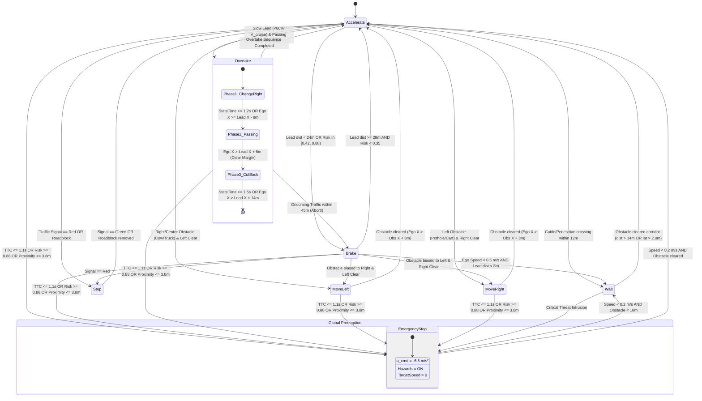

# Stateflow Behavioral Decision Logic: 8-State Tactical Driving Supervisor
**BharatDrive-AI — MathWorks Autonomous Driving Hackathon**

---

## 1. System Overview & State Machine Diagram

The **Stateflow Decision Supervisor** operates at the tactical decision level ($10\text{ Hz}$ sampling rate), bridging perception and risk evaluation with motion planning and low-level actuation. It evaluates dynamic multi-agent conditions to deterministically select among eight discrete driving states:

1. **`Accelerate`**: Free-flow cruising up to target speed along the corridor centerline.
2. **`Brake`**: Controlled longitudinal deceleration when trailing a slower lead or approaching hazard zones.
3. **`Overtake`**: Multi-phase tactical overtaking sequence (Lane Change Right $\to$ Accelerated Pass $\to$ Cut-Back Left).
4. **`Wait`**: Zero/creeping velocity state waiting for cattle or pedestrians to clear the roadway.
5. **`Stop`**: Service braking to a full stop at red traffic signals, pedestrian zebra crossings, or road closures.
6. **`Emergency Stop`**: Maximum deceleration ($-6.5\text{ m/s}^2$) fail-safe override triggered on imminent collision ($TTC \le 1.1\text{ s}$ or $\mathcal{R}_{max} \ge 0.88$).
7. **`Move Left`**: Tactical lateral deflection ($-1.25\text{ m}$) to bypass center/right obstructions (e.g. sitting cow, stalled truck).
8. **`Move Right`**: Tactical lateral deflection ($+1.25\text{ m}$) to straddle severe left-wheel track potholes or bypass roadside push-carts.

---

## 2. Transition Guards & Mathematical Formulations

To prevent high-frequency state chattering on noisy sensor inputs, a **hysteresis dwell timer** ($t_{state} \ge 0.40\text{ s}$) is enforced for all non-emergency lateral transitions.

### 1. Emergency Stop (Priority 1 — Preemptive Interrupt)
Transitions from **ANY** state into `EmergencyStop` if:
$$\mathcal{C}_{emergency} = (TTC \in (0, 1.10]\text{ s}) \;\lor\; (\mathcal{R}_{max} \ge 0.88) \;\lor\; (d_{lead} \le 3.8\text{ m} \;\land\; v_{ego} > 0.5\text{ m/s} \;\land\; |y_{obs} - y_{ego}| < 1.4\text{ m})$$
- Actuation: $a_{cmd} = -6.50\text{ m/s}^2$ (Tata Nexon EV ABS limit), $v_{target} = 0$, Hazard Blinkers = `TRUE`.

### 2. Controlled Stop (Priority 2)
Transitions into `Stop` if:
$$\mathcal{C}_{stop} = (\text{SignalState} == \text{Red}) \;\lor\; (\text{Class} == \text{Roadblock})$$
- Actuation: $a_{cmd} = -2.50\text{ m/s}^2$, $v_{target} = 0$, comfort deceleration to stop line.

### 3. Wait (Priority 3 — Indian Cattle / Pedestrian Protocol)
Transitions into `Wait` if:
$$\mathcal{C}_{wait} = (\text{Class} \in \{\text{Cattle}, \text{Pedestrian}\}) \;\land\; (d_{obs} < 12.0\text{ m}) \;\land\; (v_{ego} < 2.5\text{ m/s} \;\lor\; d_{obs} < 6.0\text{ m}) \;\land\; |y_{obs} - y_{ego}| < 1.6\text{ m}$$
- Actuation: $a_{cmd} = -1.50\text{ m/s}^2$, $v_{target} = 0$, Hazards = `TRUE`.
- **Courteous Horn**: If $t_{wait} > 1.50\text{ s}$, activates acoustic horn pulse ($Horn = \text{TRUE}$) to safely encourage animal to clear the travel corridor.

### 4. Tactical Nudge Left / Right (Priority 4)
- **Move Left**:
  $$\mathcal{C}_{move\_left} = (t_{state} \ge 0.4\text{ s}) \;\land\; (d_{obs} < 30.0\text{ m}) \;\land\; (y_{obs} \ge -0.2\text{ m}) \;\land\; (d_{clear,left} \ge 1.6\text{ m})$$
  Actuation: $\Delta d_{target} = -1.25\text{ m}$, $v_{target} = \min(v_{ego}, 0.85 \cdot v_{cruise})$.
- **Move Right**:
  $$\mathcal{C}_{move\_right} = (t_{state} \ge 0.4\text{ s}) \;\land\; (d_{obs} < 30.0\text{ m}) \;\land\; (y_{obs} \le 0.2\text{ m}) \;\land\; (d_{clear,right} \ge 1.6\text{ m}) \;\land\; (d_{oncoming} \ge 45.0\text{ m})$$
  Actuation: $\Delta d_{target} = +1.25\text{ m}$, $v_{target} = \min(v_{ego}, 0.85 \cdot v_{cruise})$.

### 5. Multi-Phase Overtake (Priority 5)
Initiation condition (Right-Hand Drive asymmetric pass on right):
$$\mathcal{C}_{overtake} = (t_{state} \ge 0.4\text{ s}) \;\land\; (\text{Class} \in \{\text{Auto}, \text{Cycle}, \text{Truck}\}) \;\land\; (d_{obs} \in [10, 25]\text{ m}) \;\land\; (v_{lead} < 0.6 \cdot v_{cruise}) \;\land\; (d_{oncoming} \ge 75\text{ m}) \;\land\; (W_{road} \ge 6.5\text{ m})$$

- **Sub-Phase 1 (Lane Change Right)**: $\Delta d = +1.80\text{ m}$, $a_{cmd} = +1.0\text{ m/s}^2$. Guard: $t_{phase} \ge 1.2\text{ s} \lor x_{ego} \ge x_{lead} - 8.0\text{ m}$.
- **Sub-Phase 2 (Accelerated Pass)**: $\Delta d = +1.80\text{ m}$, $v_{target} = 1.15 \cdot v_{cruise}$, $a_{cmd} = +2.0\text{ m/s}^2$. Guard: $x_{ego} > x_{lead} + 6.0\text{ m}$.
- **Sub-Phase 3 (Cut-Back Left)**: $\Delta d = 0.0\text{ m}$, re-aligning with primary lane. Guard: $t_{phase} \ge 1.5\text{ s} \lor x_{ego} > x_{lead} + 14.0\text{ m}$.
- **Emergency Abort**: If $d_{oncoming} < 45.0\text{ m}$ during Phase 1 or 2, instantly aborts to `Brake`!

### 6. Brake (Priority 6)
$$\mathcal{C}_{brake} = (d_{lead} < 24.0\text{ m} \;\land\; v_{rel} > 0.5\text{ m/s}) \;\lor\; (\mathcal{R}_{max} \in [0.42, 0.88))$$
Actuation: $a_{cmd} = \max(-4.50, \frac{v_{lead} - v_{ego}}{1.20})$, $v_{target} = 0.90 \cdot v_{lead}$.

### 7. Accelerate (Priority 7 — Free Flow)
Default state when $d_{lead} \ge 28.0\text{ m}$, $\mathcal{R}_{max} < 0.35$.
Actuation: $a_{cmd} = \min(2.50, \frac{v_{cruise} - v_{ego}}{2.0})$, $v_{target} = v_{cruise}$, $\Delta d = 0.0$.

---

## 3. Simulink Bus Interface

| Port / Bus Element | Data Type | Units | Description |
|---|---|---|---|
| `State` | `int32` | enum | Active state index (1:Accelerate ... 8:MoveRight) |
| `TargetSpeed` | `double` | m/s | Commanded longitudinal velocity setpoint |
| `TargetAccel` | `double` | m/s² | Commanded acceleration ($[-6.5, +2.5]$) |
| `TargetLateralOffset` | `double` | m | Commanded lateral lane offset ($\Delta d$) |
| `OvertakePhase` | `int32` | 0..3 | Current overtake phase (0=None, 1=Out, 2=Pass, 3=CutBack) |
| `Horn` | `boolean` | 0/1 | Acoustic horn trigger for cattle/pedestrians |
| `HazardLights` | `boolean` | 0/1 | Hazard emergency flashers trigger |
